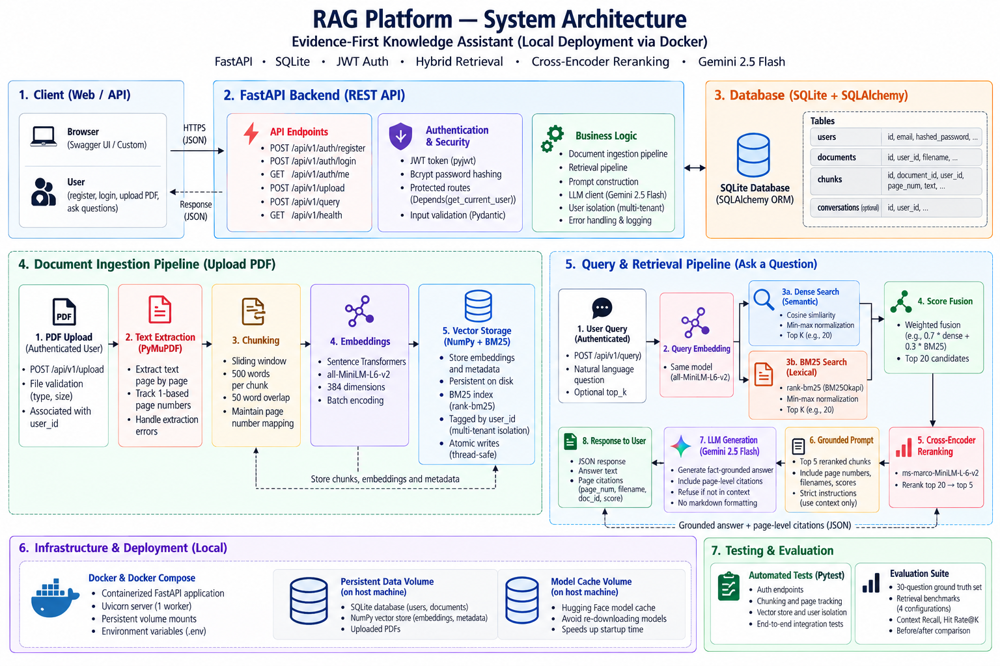

# RAG Platform — Evidence-First Knowledge Assistant

A production-oriented Retrieval-Augmented Generation system built from scratch — no LangChain, no LlamaIndex. Every component of the pipeline is implemented directly, explainable, and production-hardened.

**Ask questions about your documents. Get cited, grounded answers with multi-tenant privacy.**

> Built by [Kanishk Vikram Singh](https://github.com/kanishk-16)

---

## What it does

- **Multi-Tenant User Isolation**: Secure registration and login via JWT authentication. Documents, embeddings, and queries are strictly scoped to the authenticated user.
- **Document Ingestion**: Upload PDF documents via REST API with automated text extraction, chunking, and vector embedding.
- **Hybrid Retrieval**: Combines BM25 lexical keyword matching and dense semantic similarity with min-max score normalization and cross-encoder reranking.
- **Evidence-First Answers**: Ask natural language questions and get grounded answers strictly sourced from the document context.
- **Verifiable Citations**: Every answer includes page-level citations (`page_num`, `doc_id`, `filename`, `score`).
- **Grounded Refusal**: Refuses to answer and avoids hallucinations when information is missing from the document context.

---

## Architecture



<details>
<summary><b>Click to expand ASCII flow diagram</b></summary>

```
Client (Authorized via JWT Bearer Token)
    │
    ├── POST /api/v1/upload (file.pdf)
    │     │
    │     ▼
    │   PyMuPDF (fitz)        → Extract text page by page with 1-based page numbers
    │     │
    │     ▼
    │   Sliding Window        → 500 words per chunk, 50-word overlap
    │     │
    │     ▼
    │   Sentence Transformers → 384-dim embeddings (all-MiniLM-L6-v2)
    │     │
    │     ▼
    │   Numpy Vector Store    → Atomic disk store + BM25 index tagged by user_id
    │
    └── POST /api/v1/query (question, top_k)
          │
          ▼
        Filter by user_id     → Scope retrieval strictly to authenticated user's documents
          │
          ▼
        Hybrid Retrieval      → 0.7 * Dense Cosine + 0.3 * BM25 Lexical
          │
          ▼
        Top-20 Candidates     → Cross-Encoder Reranker (ms-marco-MiniLM-L-6-v2)
          │
          ▼
        Top-5 Reranked Chunks → Grounded Prompt Context
          │
          ▼
        Gemini 2.5 Flash      → Fact-grounded answer + page-level citations
```
</details>

### Tech Stack

| Layer | Technology |
|---|---|
| API | FastAPI + Uvicorn |
| Authentication | JWT (`pyjwt`) + `bcrypt` password hashing |
| Database | SQLite + SQLAlchemy ORM |
| PDF Loading | PyMuPDF (`fitz`) |
| Embeddings | `sentence-transformers` (`all-MiniLM-L6-v2`, 384-dim) |
| Lexical Search | `rank-bm25` (BM25Okapi) |
| Reranker | `cross-encoder/ms-marco-MiniLM-L-6-v2` |
| Vector Search | Numpy (cosine similarity, atomic persistence) |
| LLM | Google Gemini 2.5 Flash |
| Config | Pydantic Settings (`SettingsConfigDict`) + `python-dotenv` |
| Testing | `pytest` + `httpx` (TestClient) |
| Deployment | Docker + Docker Compose (Live on Railway) |

**🚀 Live Demo:** [https://rag-project-production-413e.up.railway.app/docs](https://rag-project-production-413e.up.railway.app/docs)

---

## Project Structure

```
rag-platform/
├── backend/
│   ├── app/
│   │   ├── api/
│   │   │   ├── auth.py            # User registration, login, JWT dependency
│   │   │   └── routes.py          # Document upload & grounded query endpoints
│   │   ├── core/
│   │   │   ├── config.py          # Pydantic Settings & environment variables
│   │   │   └── security.py        # Bcrypt hashing & JWT token encode/decode
│   │   ├── db/
│   │   │   └── session.py         # SQLAlchemy engine & SQLite session provider
│   │   ├── models/
│   │   │   └── user.py            # User SQLAlchemy model
│   │   ├── ingestion/
│   │   │   ├── loader.py          # PyMuPDF page-aware text extraction
│   │   │   └── chunker.py         # Sliding window word chunker
│   │   ├── embeddings/
│   │   │   └── embedder.py        # SentenceTransformer batch embeddings
│   │   ├── retrieval/
│   │   │   └── vector_store.py    # Hybrid search, BM25, CrossEncoder, multi-tenancy
│   │   ├── llm/
│   │   │   └── client.py          # Gemini API + grounded anti-hallucination prompt
│   │   └── main.py                # FastAPI application entrypoint & table creation
│   ├── tests/
│   │   ├── test_auth.py           # Registration, login, auth protection, tenant isolation
│   │   ├── test_chunker.py        # Chunker unit tests & page number tracking
│   │   └── test_vector_store.py   # Normalization & user isolation tests
│   ├── benchmark_4_configs.py     # 4-pipeline retrieval benchmark runner
│   ├── eval_runner.py             # Quantitative evaluation suite (retrieval & LLM judge)
│   └── requirements.txt
├── eval/
│   ├── eval_set.json              # 30 reviewed domain Q&A pairs
│   └── results/
│       ├── baseline.json          # Baseline retrieval results
│       ├── phase6_hybrid.json     # Hybrid + cross-encoder evaluation results
│       └── pipeline_comparison_4_configs.json # Full 4-config benchmark metrics
├── docker/Dockerfile
├── docker-compose.yml
├── .env.example
├── README.md
└── ROADMAP.md
```

---

## Evaluation & Benchmark Findings

A 30-question evaluation set built from domain documents (`eval/eval_set.json`) was used to benchmark retrieval quality across four architectural configurations under identical conditions.

### 4-Configuration Retrieval Benchmark (30 Questions)

| Run | Pipeline Configuration | Mean Context Recall | Hit Rate@5 | Pure Retrieval Latency (Avg / p95) | End-to-End Latency* (Avg / p95) |
| :---: | :--- | :---: | :---: | :---: | :---: |
| **1** | **Dense only** (`all-MiniLM-L6-v2`) | `0.6750` | `96.67%` (29/30) | `0.08 ms` / `0.09 ms` | `19.37 ms` / `19.38 ms` |
| **2** | **BM25 only** (Pure Lexical) | `0.7005` | `100.00%` (30/30) | `0.17 ms` / `0.24 ms` | `0.17 ms` / `0.24 ms` |
| **3** | **Dense + BM25 + RRF** ($k=60$) | `0.6882` | `96.67%` (29/30) | `0.26 ms` / `0.41 ms` | `19.55 ms` / `19.70 ms` |
| **4** | **Dense + BM25 + RRF + Cross-Encoder** | **`0.7259`** | **`100.00%` (30/30)** | `1,783.70 ms` / `2,029.88 ms` | `1,802.99 ms` / `2,049.16 ms` |

*\*End-to-End Latency includes query embedding computation (`avg = 19.29 ms` on CPU).*

### Key Findings & Engineering Trade-offs

1. **Why Pure BM25 Performs Strongly on Technical Texts (`0.7005` recall):**
   - The document contains exact company names (*"TCS, Infosys, Wipro"*), acronyms (*"DBMS, SQL, DSA, OS"*), and specific framework names. Lexical matching excels when queries share literal vocabulary with target passages.
2. **Dense Semantic Search Recovers Paraphrases:**
   - Dense embeddings capture semantic similarity and synonyms, but can drop ranks on rare tokens or acronyms.
3. **The Accuracy vs. Latency Trade-off with Cross-Encoder Reranking:**
   - Adding **`ms-marco-MiniLM-L-6-v2`** cross-encoder achieved the **highest recall (`0.7259`)** and a **flawless `100% Hit Rate@5`** (rescuing previously missed queries like `q29` and improving `q17` recall from `0.38` to `0.85`).
   - *The Latency Cost:* Bi-encoders (runs 1–3) embed queries and documents separately, enabling sub-20ms lookup. The cross-encoder performs token-level joint attention across all 20 `(query, chunk)` candidate pairs, introducing an ~1.8s CPU inference latency.
   - *Design Takeaway:* For low-latency real-time apps, **Dense + BM25 (RRF)** provides balanced accuracy under 20ms; for high-stakes accuracy where precision is paramount, **Cross-Encoder reranking** provides the optimal retrieval fidelity.

### Metric Definitions
- **Context Recall**: Fraction of key domain terms from the ground-truth answer present in the retrieved chunks.
- **Hit Rate@5**: Percentage of queries where at least one retrieved chunk in the top-5 meets the relevance recall threshold ($\ge 0.3$).

---

## API Endpoints

### Authentication

| Method | Endpoint | Description |
|---|---|---|
| POST | `/api/v1/auth/register` | Register a new user account |
| POST | `/api/v1/auth/login` | Authenticate and obtain JWT access token |
| GET | `/api/v1/auth/me` | Retrieve current authenticated user profile |

### Core RAG

| Method | Endpoint | Description |
|---|---|---|
| GET | `/api/v1/health` | Liveness check (Docker & Railway monitoring) |
| POST | `/api/v1/upload` | Upload & index PDF (Authenticated, max 25MB) |
| POST | `/api/v1/query` | Ask grounded question (Authenticated, tenant-isolated) |

---

### Usage Examples

#### 1. Register & Login

```bash
# Register
curl -X POST http://localhost:8000/api/v1/auth/register \
  -H "Content-Type: application/json" \
  -d '{"email": "alex@example.com", "password": "securepassword123"}'

# Login to get JWT
curl -X POST http://localhost:8000/api/v1/auth/login \
  -H "Content-Type: application/json" \
  -d '{"email": "alex@example.com", "password": "securepassword123"}'
```

Response:
```json
{
  "access_token": "eyJhbGciOiJIUzI1NiIsInR5cCI6IkpXVCJ9...",
  "token_type": "bearer"
}
```

#### 2. Upload a Document

```bash
curl -X POST http://localhost:8000/api/v1/upload \
  -H "Authorization: Bearer <YOUR_ACCESS_TOKEN>" \
  -F "file=@your_document.pdf"
```

Response:
```json
{
  "doc_id": "86edab5d-...",
  "filename": "your_document.pdf",
  "chunks_created": 42,
  "user_id": "9b1deb4d-...",
  "message": "Document processed and indexed successfully."
}
```

#### 3. Query the Document

```bash
curl -X POST http://localhost:8000/api/v1/query \
  -H "Authorization: Bearer <YOUR_ACCESS_TOKEN>" \
  -H "Content-Type: application/json" \
  -d '{"question": "What is the recommended subject ranking?", "top_k": 5}'
```

Response:
```json
{
  "answer": "For general SWE roles, DSA leads, followed by OOP/OOD, DBMS and SQL, OS, networking, and system design.",
  "sources": [
    {
      "doc_id": "86edab5d-...",
      "chunk_index": 3,
      "page_num": 1,
      "filename": "your_document.pdf",
      "score": 0.9669
    }
  ]
}
```

Interactive API documentation with Bearer authentication is available at `http://localhost:8000/docs`.

---

## Local Setup

### Prerequisites
- Python 3.10+
- A Google Gemini API key (obtain from [Google AI Studio](https://aistudio.google.com/app/apikeys))

### Steps

```bash
# 1. Clone the repo
git clone https://github.com/kanishk-16/rag-project.git
cd rag-project

# 2. Create virtual environment
cd backend
python -m venv venv

# Windows
venv\Scripts\activate
# Mac/Linux
source venv/bin/activate

# 3. Install dependencies
pip install -r requirements.txt

# 4. Set up environment variables
cp ../.env.example .env
# Edit .env and set your GOOGLE_API_KEY

# 5. Run the server
uvicorn app.main:app --reload

# 6. Open interactive API docs
# Visit http://localhost:8000/docs
```

---

## Running Tests

Run the full automated test suite (chunker, vector store isolation, authentication):

```bash
cd backend
pytest tests/ -v
```

Run retrieval benchmarks:

```bash
cd backend
python benchmark_4_configs.py
```

---

## Key Engineering Decisions

**Direct Implementation (No LangChain / LlamaIndex)**
Every component is implemented directly — loader, chunker, embedder, vector store, LLM client. This ensures full algorithmic visibility, explainability in technical interviews, and zero framework overhead.

**Multi-Tenancy & Data Isolation**
Unlike typical student RAG projects that mix all documents in a single shared store, every uploaded chunk is tagged with the authenticated `user_id`. Queries strictly filter retrieval to the authenticated user's documents.

**Hybrid BM25 + Dense Semantic Fusion**
Dense embeddings understand conceptual meaning, but miss technical acronyms and verbatim identifiers. BM25 captures exact token matches. Min-max normalization prevents disparate score scales from biasing results.

**Cross-Encoder Reranking**
Bi-encoders independently encode queries and documents for fast initial retrieval. The cross-encoder (`ms-marco-MiniLM-L-6-v2`) performs joint token attention over top-20 candidates, boosting context recall to `0.7259` and achieving `100% Hit Rate@5`.

**Thread-Safe Atomic Persistence**
Writes to the disk-backed vector store utilize `threading.Lock()` and atomic file renaming (`.tmp` to destination) to prevent file corruption during concurrent uploads or server restarts.

---

## Status & Roadmap

**Achieved Milestones:**
- ✅ **Phase 1: Core RAG Pipeline** (PyMuPDF text extraction, sliding window chunker, `all-MiniLM-L6-v2` embeddings, Numpy vector store).
- ✅ **Phase 2: Metadata & Citations** (Page number, filename, timestamp tracking; page-level citations in query responses).
- ✅ **Phase 4: Grounded Prompt & Refusal** (Strict anti-hallucination prompt template, explicit missing-context refusal).
- ✅ **Phase 5: Authentication & Multi-Tenancy** (SQLite + SQLAlchemy, bcrypt hashing, JWT Bearer tokens, user-isolated document storage and retrieval).
- ✅ **Phase 6: Hybrid Search & Cross-Encoder Reranking** (BM25 lexical index + dense semantic vector fusion, cross-encoder reranking, 100% Hit Rate@5 benchmark).
- ✅ **Phase 10: Evaluation Suite** (30-question ground-truth evaluation set, multi-configuration benchmark measuring context recall, hit rate, and latency trade-offs).
- ✅ **Deployment** (Containerized with Docker & Docker Compose, deployed live on Railway).

**Next Up:**
- 🔄 **Phase 8:** Real-time token streaming (`StreamingResponse` with Gemini streaming API).

---

## Author

**Kanishk Vikram Singh**
[GitHub](https://github.com/kanishk-16)